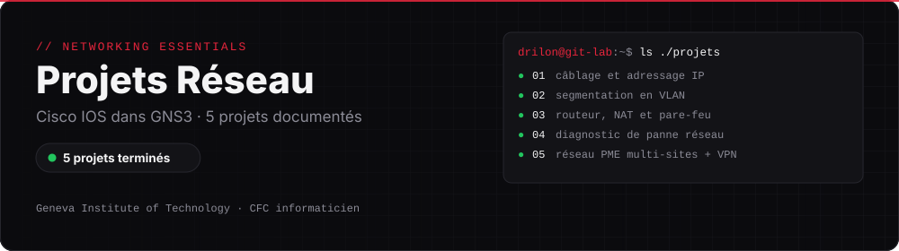

  
  
  
  

# Projets Réseau

Documentation de mes projets du module **Networking Essentials**, réalisés au **Geneva Institute of Technology** pendant ma première année de CFC d'informaticien. Les réseaux sont montés dans **GNS3** avec des routeurs et switchs Cisco configurés en ligne de commande.

**Cours :** Networking Essentials — Infrastructure informatique et réseau d'une petite entreprise · **Classe :** E1A

Chaque dossier contient une fiche complète : contexte du projet, étapes réalisées, captures d'écran, incidents rencontrés et résolutions.

## Projets

| Projet | Description |
|---|---|
| [Projet 1 — Câblage et adressage IP](./projet-1-cablage-adressage-ip) | Bureau de 8 postes en 192.168.10.0/24, IP statiques, 64 tests ping réussis |
| [Projet 2 — Segmentation en VLAN](./projet-2-segmentation-vlan) | VLAN 10 Comptabilité et VLAN 20 Employés sur un switch Cisco, isolement testé dans les deux sens |
| [Projet 3 — Routeur / pare-feu](./projet-3-routeur-pare-feu) | Interfaces WAN et LAN, NAT overload, ACL qui bloque HTTP et laisse passer le reste |
| [Projet 4 — Diagnostic d'une panne réseau](./projet-4-diagnostic-panne-reseau) | 3 pannes simulées (câble, VLAN, passerelle), diagnostic couche par couche, rapport d'intervention |
| [Projet 5 — Réseau PME multi-sites](./projet-5-reseau-pme-multi-sites) | Genève + Lausanne : plan d'adressage, VLAN, ligne dédiée puis VPN IPsec site-à-site |

---

## Voir aussi

- [Projets PPE · IT Essentials](https://github.com/dnhj-06/ppe-projects) : postes de travail Windows
- [Projets Virtualisation](https://github.com/dnhj-06/projets-virtualisation) : VMware Workstation et ESXi
- [Infrastructure VMware en équipe](https://github.com/dnhj-06/cluster-vsphere) : 3 serveurs ESXi, vCenter et Active Directory
- [Mon CV et mes contacts](https://dnhj-06.github.io)
- [← Retour à mon profil](https://github.com/dnhj-06)
